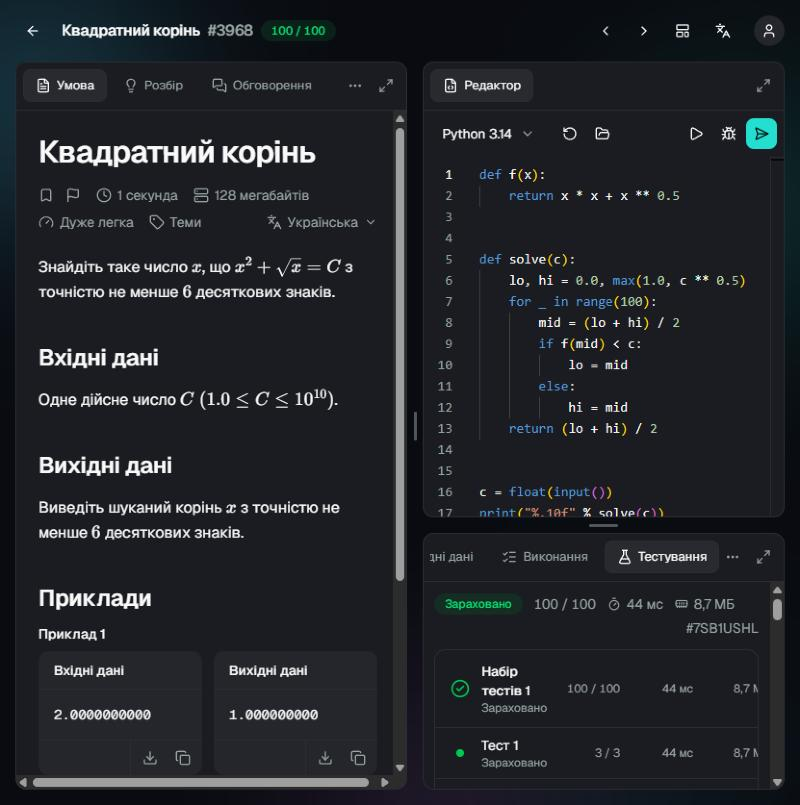

# Алгоритми і структури даних. Лабораторні роботи 3–4

## Задача 3.6. Завзятий колекціонер метеликів
Eolymp: https://eolymp.com/uk/problems/3966

Код: [t03_06_e3966.py](t03_06_e3966.py)

Масив номерів відсортований, тому для кожного запиту виконуємо бінарний пошук: O(log n) на запит, загалом O(m log n).

Результат перевірки на Eolymp: **100%**

---

## Задача 3.7. Мутанти
Eolymp: https://eolymp.com/uk/problems/3970

Код: [t03_07_e3970.py](t03_07_e3970.py)

Кольори впорядковані за неспаданням. Для кожного запиту x бінарним пошуком знаходимо першу позицію елемента ≥ x (lower_bound) і першу позицію елемента > x (upper_bound). Кількість звіряток кольору x дорівнює upper_bound − lower_bound. Складність O(m log n).

Результат перевірки на Eolymp: **100%**

---

## Задача 4.2. Квадратний корінь
Eolymp: https://eolymp.com/uk/problems/3968

Код: [t04_02_e3968.py](t04_02_e3968.py)

Функція f(x) = x² + √x монотонно зростає на [0, +∞), тому корінь рівняння f(x) = C шукаємо методом бісекції на відрізку [0, max(1, √C)]. 100 ітерацій дають точність значно кращу за 10⁻⁶.

Результат перевірки на Eolymp: **100%**

---

## Задача 4.4. На відрізку [1.6, 3] знайдіть корінь рівняння sin x = x / 3

Код: [t04_04.py](t04_04.py), результат: [t04_04_result.txt](t04_04_result.txt)

Розглядаємо f(x) = sin x − x/3. f(1.6) ≈ 0.466 > 0, f(3) ≈ −0.859 < 0, тому на відрізку є корінь. Знаходимо його методом бісекції з точністю 10⁻¹².

**x ≈ 2.278863**

---

## Задача 4.5. На відрізку [0, 2] знайдіть корінь рівняння x³ + 4x² + x − 6 = 0

Код: [t04_05.py](t04_05.py), результат: [t04_05_result.txt](t04_05_result.txt)

f(0) = −6 < 0, f(2) = 16 > 0, тому на відрізку є корінь. Метод бісекції з точністю 10⁻¹².

**x = 1** (перевірка: 1 + 4 + 1 − 6 = 0)
